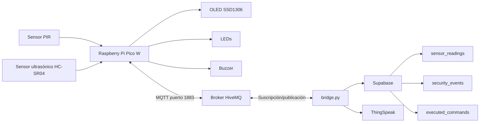
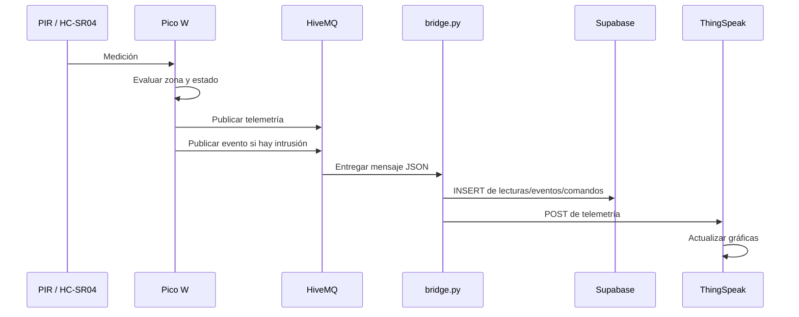

# Sistema IoT de Monitoreo y Control Inteligente

## Sistema de Seguridad

Proyecto de Desarrollo orientado a la detección de movimiento e intrusiones mediante una Raspberry Pi Pico W simulada en Wokwi. El sistema clasifica la distancia del sensor ultrasónico en zonas segura, intermedia y de peligro, activa LEDs y buzzer cuando corresponde y publica telemetría y eventos mediante MQTT.

## Integrantes y roles

| Integrante | Rol/Aporte |
|---|---|
| Alexander toribio | Hardware y simulación Wokwi |
| Ricardo Camarena | Desarrollo Python y MQTT |
| Miguel Caballero | Base de datos y servicios de nube |
| [Integrante 4] | Documentación y evidencias |

## Tecnologías utilizadas

- Wokwi con Raspberry Pi Pico W
- MicroPython
- Python
- HiveMQ Broker MQTT
- Supabase
- ThingSpeak
- Visual Studio Code

## Hardware virtual

- Sensor PIR: GP28
- Sensor ultrasónico HC-SR04: TRIG GP3 y ECHO GP2
- OLED SSD1306: SDA GP0 y SCL GP1
- Buzzer: GP15
- LED verde armado: GP16
- LED rojo de alarma: GP17
- Botón de emergencia: GP14

## Arquitectura



## Instalación local

### 1. Crear el entorno virtual

Desde PowerShell, en la raíz del proyecto:

```powershell
cd C:\xampp\htdocs\Parcial2
py -3.11 -m venv .venv
.\.venv\Scripts\Activate.ps1
python -m pip install --upgrade pip
```

### 2. Instalar dependencias

```powershell
python -m pip install -r requirements.txt
```

### 3. Configurar Supabase y ThingSpeak

En `bridge.py`, configure:

- `SUPABASE_URL`: URL base del proyecto Supabase.
- `SUPABASE_KEY`: clave publishable o anon válida.
- `THINGSPEAK_WRITE_API_KEY`: Write API Key del canal ThingSpeak.
- `THINGSPEAK_URL`: normalmente `https://api.thingspeak.com/update`.

No utilice una clave `service_role` o `secret` en `bridge.py`, porque este archivo se ejecuta localmente y expone sus credenciales.

Ejecute el bloque SQL de `script.sql` en Supabase SQL Editor antes de iniciar el puente.

### 4. Ejecutar el puente MQTT

Mantenga abierta esta terminal:

```powershell
cd C:\xampp\htdocs\Parcial2
.\.venv\Scripts\Activate.ps1
python bridge.py
```

La salida debe confirmar la conexión a HiveMQ y la suscripción al tópico:

```text
utp/parcial2/seguridad/#
```

## Ejecución en Wokwi desde VS Code

1. Instale la extensión oficial **Wokwi Simulator** (`Wokwi.wokwi-vscode`).
2. Instale el firmware de MicroPython para Raspberry Pi Pico W.
3. Cree `wokwi.toml` junto a `diagram.json`.
4. Inicie la simulación con **Wokwi: Start Simulator** o el botón Play.
5. Mantenga la simulación visible y active el servidor RFC2217 en el puerto `4000`.
6. Instale `mpremote`:

```powershell
python -m pip install mpremote
```

7. Desde otra terminal, cargue los archivos MicroPython:

```powershell
cd C:\xampp\htdocs\Parcial2\Sistema_Iot_seguridad

python -m mpremote connect port:rfc2217://localhost:4000 fs cp main.py :main.py
python -m mpremote connect port:rfc2217://localhost:4000 fs cp config.py :config.py
python -m mpremote connect port:rfc2217://localhost:4000 fs cp model_db.py :model_db.py
python -m mpremote connect port:rfc2217://localhost:4000 fs cp view_oled.py :view_oled.py
python -m mpremote connect port:rfc2217://localhost:4000 fs cp view_actuators.py :view_actuators.py
python -m mpremote connect port:rfc2217://localhost:4000 fs cp controller_mqtt.py :controller_mqtt.py
python -m mpremote connect port:rfc2217://localhost:4000 fs cp umqttsimple.py :umqttsimple.py
python -m mpremote connect port:rfc2217://localhost:4000 fs cp ssd1306.py :ssd1306.py
```

8. Ejecute el programa o reinicie el Pico virtual:

```powershell
python -m mpremote connect port:rfc2217://localhost:4000 run main.py
```

## Flujo de datos



## Control desde MQTT

El tópico de comandos es:

```text
utp/parcial2/seguridad/utp2026_r1/comandos
```

Comandos admitidos:

- `ARM`: arma el sistema.
- `DISARM`: desarma el sistema.
- `CLEAR_ALARM`: silencia la alarma temporalmente.
- `HISTORY`: solicita un evento de historial.

## Estructura principal

```text
Parcial2/
├── bridge.py
├── README.md
├── requirements.txt
├── script.sql
└── Sistema_Iot_seguridad/
    ├── main.py
    ├── config.py
    ├── controller_mqtt.py
    ├── controller_cloud.py
    ├── model_db.py
    ├── view_actuators.py
    ├── view_oled.py
    ├── ssd1306.py
    ├── umqttsimple.py
    └── diagram.json
```

